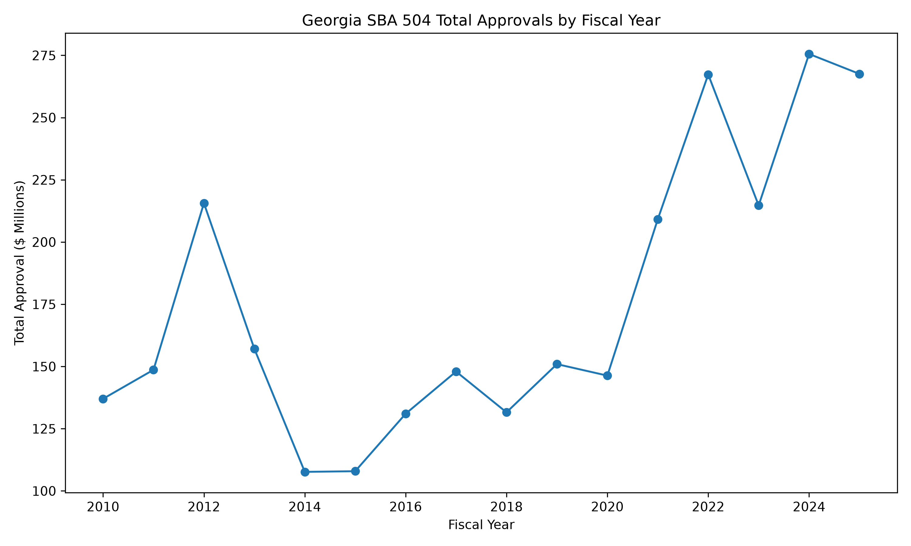

# SBA 504 Georgia Lending Analysis

A Python data-analysis project using public U.S. Small Business Administration (SBA) 504 loan data to examine lending activity in Georgia.

The project loads and cleans raw SBA data, analyzes lending by county, industry, and fiscal year, calculates derived business metrics, creates a trend visualization, exports reusable CSV summaries, and uses automated tests to verify key analytical logic.

## Project Questions

This version focuses on three questions:

- Which Georgia counties receive the most SBA 504 capital?
- Which industries receive the most SBA 504 capital?
- How has Georgia SBA 504 lending changed over time?

The analysis also calculates jobs supported per $1 million approved and year-over-year changes in loan volume and approval dollars.

## Key Findings

The Georgia dataset contains 3,229 SBA 504 loan records from FY2010 through FY2026.

A few patterns stand out:

- Fulton, Gwinnett, and Cobb counties lead Georgia in total SBA 504 approval dollars.
- Hotels and motels represent the largest industry category by total approved capital in the Georgia data.
- Georgia's average 504 loan size increased substantially over the period. Average approval size was approximately $525,000 in FY2010 compared with about $1.42 million in FY2025.
- Loan volume and total approval dollars do not always move together. In several years, approval dollars increased even when the number of loans declined, indicating a shift toward larger individual approvals.

FY2026 data is available only through June 30, 2026, so it is treated as a partial year and is excluded from completed-year trend comparisons.

## Trend



The completed-year trend shows a substantial increase in total SBA 504 capital approved in Georgia after 2020, even though loan counts did not increase proportionally.

## Data Workflow

The project separates the data workflow into individual responsibilities:

```text
Raw SBA data
    ↓
Load
    ↓
Clean and normalize
    ↓
Filter to Georgia
    ↓
Analyze
    ├── County
    ├── Industry
    └── Fiscal year
    ↓
Visualize
    ↓
Export
```

During exploration, the SBA data revealed inconsistent industry descriptions for identical NAICS codes. The cleaning and analysis logic was adjusted so that the NAICS code serves as the industry identifier rather than relying on descriptive text alone.

This prevents wording differences such as:

```text
624410  Child Day Care Services
624410  Child Care Services
```

from incorrectly appearing as separate industries.

## Project Structure

```text
backend-api-immersion/
│
├── data/
│   └── raw/                  # Local SBA source files
│
├── outputs/
│   ├── georgia_504_approvals_by_year.png
│   ├── georgia_county_summary.csv
│   ├── georgia_industry_summary.csv
│   └── georgia_yearly_summary.csv
│
├── src/
│   ├── load_504.py           # Loads raw SBA data
│   ├── clean_504.py          # Selects and normalizes working data
│   ├── analyze_504.py        # County, industry, and yearly analysis
│   ├── plot_504.py           # Creates the yearly trend chart
│   └── export_504.py         # Exports analytical results to CSV
│
├── tests/
│   └── test_analysis.py      # Automated analysis tests
│
├── main.py                   # Initial FastAPI scaffold
├── pytest.ini
├── requirements.txt
└── README.md
```

## Technologies Used

- Python
- pandas
- matplotlib
- pytest
- pathlib
- Git / GitHub

FastAPI is included in the repository as an initial project scaffold and is planned for a later API layer.

## Running the Project

Install the project dependencies:

```bash
pip install -r requirements.txt
```

Run the analysis:

```bash
python src/analyze_504.py
```

Generate the chart:

```bash
python src/plot_504.py
```

Export the analytical summaries:

```bash
python src/export_504.py
```

## Testing

Automated tests currently verify:

- county-level aggregation
- NAICS grouping when descriptions differ
- fiscal-year and year-over-year calculations

Run the test suite with:

```bash
pytest -v
```

## Data Source

The project uses public SBA 504 FOIA loan data covering FY2010 through June 30, 2026, along with the SBA 7(a)/504 data dictionary.

Raw source files are kept locally and are excluded from the repository.

## Limitations

This project identifies patterns in SBA 504 lending data but does not attempt to establish their economic causes.

For example, the increase in average loan size could reflect changes in asset prices, industry mix, SBA policy, lender behavior, geographic development, inflation, or broader economic conditions. Those questions require additional external data before drawing conclusions.

## Future Research Questions

Future analysis could examine:

- Why did average Georgia SBA 504 approval size rise so sharply?
- Did the change come from asset prices, industry mix, policy, lender behavior, geography, or broader economic conditions?
- Did Georgia differ from the Southeast and the United States overall?

## Future Technical Work

Planned extensions include:

- REST API and JSON data ingestion
- FRED economic data integration
- SQL / relational database storage
- regional and national comparisons
- macroeconomic context for lending trends
- FastAPI endpoints for selected analytical results

## Purpose

This project was built as a hands-on exercise in working with real public data and developing a repeatable Python workflow for data ingestion, cleaning, analysis, testing, visualization, and export.
